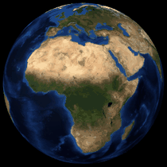

<h1 align="center">Ruibing Wang </h1>

PhD Candidate · <b>Surveying and Mapping Engineering</b> 
School of Artificial Intelligence, China University of Geosciences, Beijing

---

## About

I work on **3D reconstruction and geometric perception from multi-source data** — fusing UAV oblique photogrammetry with handheld laser scanning, pulling individual structures out of the fused result, and organising multi-scale models so they survive being loaded all at once.

The interesting part is never the point cloud. It is the seam: where one sensor's strength ends and the other's begins, how the two are registered without trusting either too much, and what "one building" even means when the whole scene arrived as a single mesh.

## Education & Experience

| Period | Position | Institution |
| :--- | :--- | :--- |
| **2026 –** | PhD, Surveying and Mapping Engineering | China University of Geosciences, Beijing · School of Artificial Intelligence |
| **2024 – 2026** | Engineer, spatial information systems | Chongqing Planning and Natural Resources Information Center |
| **2021 – 2024** | M.Eng., Surveying and Mapping Engineering | Chongqing Jiaotong University |
| **2017 – 2021** | B.Sc., Geographic Information Science | Chongqing Jiaotong University |

### PhD · 3D reconstruction and geometric perception

Continuing the master's line rather than restarting it — the same fusion problem, taken further.

- **Registration** — better initial alignment so ICP converges on the right answer instead of a plausible one
- **Semantics** — segmentation models that turn a mesh into addressable objects with attributes attached
- **Scale** — organisation and Level-of-Detail strategies that keep city-scale scenes interactive
- **Perception** — recovering usable geometry from what is cheap to capture, not only from what is expensive

### 2024 – 2026 · Chongqing Planning and Natural Resources Information Center

Core member of *Smart Industrial Land Governance*, a flagship municipal application. Parks, parcels and enterprises were documented by different departments, so no question that crossed them could be answered.

- **Spatial foundation** — multi-source park, parcel and enterprise data integrated into one base, with standardised one-file-per-entity profiles
- **Industrial chain agglomeration** — spatial big-data analysis over that base
- **Intelligent parcel recommendation** — site selection with LLM-powered natural language interaction
- **Remote site inspection** — cloud-based review without field visits
- **Idle land governance** — monitoring and cross-departmental disposal of underutilised parcels
- **Closed loop** — `planning → supply → supervision → stock revitalisation`

### 2021 – 2024 · Master's thesis

*Multi-scale 3D model integrated expression*, Chongqing Jiaotong University.

UAV oblique photogrammetry covers large areas but loses near-ground detail wherever something occludes it. Handheld laser scanning captures precisely that detail but cannot reach rooftops and does not scale by hand. The thesis fuses the two.

- Coarse feature matching before `ICP`, cutting registration iterations — final **RMSE 1.09**
- `SAM` with text and point prompts to extract building masks, vectorised and bound to attribute records — **IoU 0.75**
- `Unreal Engine` visualisation with HLOD organisation — mean frame count **+134.78 %**, load latency **−6.25 ms**
- Applied to viewshed, inundation and contour analysis

### 2017 – 2021 · Undergraduate thesis

*Development of an intelligent early-warning platform for complex environmental and ecological risks in Chongqing.*

Fifteen indicators across natural, economic and social systems, weighted by entropy, graded into five alarm levels by natural breaks, and scored per district with a normal cloud model — 38 districts, 2015 against 2019. Risk contracted toward the urban core over those four years, with the sharpest improvement in the northeast.

## Side projects

Nothing here is research. These exist because something in the house annoyed me enough to fix it: a NAS that could not answer "where is that file", a calendar that needed four clients off one dataset, a photo frame that had to run on a battery.

Most of it is self-hosted, single-binary, and allergic to dependencies. The repositories are pinned below.

## Stack

**Languages**  
<kbd>Python</kbd> <kbd>TypeScript</kbd> <kbd>JavaScript</kbd> <kbd>C++</kbd> <kbd>C</kbd> <kbd>Java</kbd>

**Geospatial**  
<kbd>PostGIS</kbd> <kbd>Cesium</kbd> <kbd>Leaflet</kbd> <kbd>Mapbox GL</kbd> <kbd>ArcGIS API</kbd> <kbd>GDAL</kbd>

**3D & rendering**  
<kbd>Unreal Engine</kbd> <kbd>Three.js</kbd> <kbd>Blender</kbd> <kbd>CloudCompare</kbd>

**Infrastructure & hardware**  
<kbd>Docker</kbd> <kbd>Linux</kbd> <kbd>SQLite FTS5</kbd> <kbd>ESP32-S3</kbd>

## Elsewhere

[vector9584.github.io](https://vector9584.github.io)

---

<b>🐈‍⬛</b>

> **About the avatar**
>
> This is Zhenzhen — a black cat, which in the right film is either good luck or a glitch.
>
> *"A black cat went past us, and then another that looked just like it."*
> *"A déjà vu is usually a glitch in the Matrix. It happens when they change something."*
>
> Nobody established which world she was walking through. The *zhēn* in her name is the character from 「梦想成真」, so she sits on this profile as a small omen: whatever you are building, may it compile on the first try.
>
> And if you see her twice, look again at what changed.
