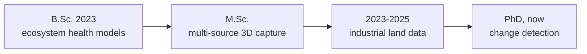

### Ruibing Wang

PhD student, Photogrammetry and Remote Sensing 
China University of Geosciences, Beijing

I put spatial data on the web, and my cloud services back on my own server.

---

I came to remote sensing through land, not through code. My master's work was about capturing a place in three dimensions; the two years after it went into making land records agree with each other; the PhD is about what changes when you look at the same place twice.

Before the PhD I spent two years at the Chongqing Planning and Natural Resources Information Center, doing data governance for industrial land — reconciling records that were never designed to be reconciled.

My current research applies monocular depth priors and decoupled 3D geometric perception to change detection in remote sensing imagery, using sparse LiDAR point clouds as supervision.

Outside the lab I write small tools for myself, and keep more ESP32 boards and self-hosted services alive than is strictly reasonable.

---

## Projects

### Maintained

**[rui-calendar](https://github.com/vector9584/rui-calendar)**
Self-hosted calendar. One dataset serving web, iOS, Android and Windows clients at the same time — CalDAV/CardDAV on Baikal behind a React + Electron + PWA front end.

<kbd>TypeScript</kbd> <kbd>React</kbd> <kbd>Electron</kbd> <kbd>PWA</kbd> <kbd>CalDAV</kbd>

**[nas-search](https://github.com/vector9584/nas-search)**
Filename search across a NAS, answered in milliseconds. A prebuilt SQLite FTS5 index means the search never touches the filesystem, and the tool has no third-party dependencies at all.

<kbd>Python</kbd> <kbd>SQLite FTS5</kbd> <kbd>Zero dependencies</kbd>

**[esp32-epd-photo](https://github.com/vector9584/esp32-epd-photo)**
An ESP32-S3 driving a four-colour e-paper panel (800×480, JD79665AA) as a photo frame. The Python side quantises photos into four-colour C arrays with Atkinson or Bayer dithering and corrects EXIF orientation; the device serves a web portal for WiFi setup.

<kbd>C</kbd> <kbd>Python</kbd> <kbd>ESP32-S3</kbd> <kbd>E-paper</kbd>

**[nowen-note](https://github.com/vector9584/nowen-note)**
Self-hosted notes — Markdown, mind maps, tasks and full-text search in one place. A fork of [croplfire/nowen-note](https://github.com/croplfire/nowen-note), deployed with a single Docker command.

<kbd>Docker</kbd> <kbd>Markdown</kbd> <kbd>Full-text search</kbd>

**[agent-field-notes](https://github.com/vector9584/agent-field-notes)**
The rules I ended up giving an AI agent that operates a real machine, along with the incidents that produced each one.

<kbd>Writing</kbd> <kbd>Agents</kbd> <kbd>Post-mortems</kbd>

<b>Earlier</b>

 

**[eco-monitoring-dashboard](https://github.com/vector9584/eco-monitoring-dashboard)**
Bachelor's thesis, 2023. A one-screen dashboard for ecological health assessment in Chongqing — land use, risk sources and risk receptors, in plain ECharts with no build step.

<kbd>JavaScript</kbd> <kbd>ECharts</kbd> <kbd>No build step</kbd>

---

## Stack

**Languages**&nbsp;&nbsp; <kbd>Python</kbd> <kbd>C++</kbd> <kbd>TypeScript</kbd> <kbd>JavaScript</kbd> <kbd>C</kbd>

**GIS**&nbsp;&nbsp; <kbd>PostGIS</kbd> <kbd>Cesium</kbd> <kbd>Leaflet</kbd> <kbd>ArcGIS JS API</kbd>

**Other**&nbsp;&nbsp; <kbd>Docker</kbd> <kbd>ESP32</kbd> <kbd>Unreal Engine</kbd>

---

[Blog](https://vector9584.github.io) &nbsp;·&nbsp; [Notes on running an agent](https://github.com/vector9584/agent-field-notes) &nbsp;·&nbsp; [Email](mailto:3104260005@email.cugb.edu.cn)

